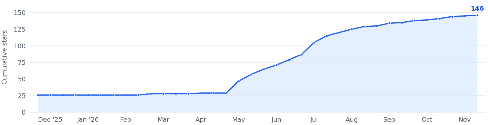

<h1 align="center">Hi there 👋, I'm Yao Jia</h1>

  <strong>Ph.D. Student in Computer Science and Technology</strong> 
  Zhejiang University

  
  
  

---

## 🔬 Research Interests

- 🧠 **Neural-to-Language Decoding** — Recovering speech and text from brain activity.
- 🎙️ **Multimodal Representation Learning** — Aligning neural, acoustic, and linguistic representations.
- 🔬 **Neural Foundation Models** — Pretraining models on neural recordings for transfer across people, sessions, and tasks.
- 💬 **Large Language Models** — Studying how language models use context and prior knowledge for reasoning and generation.
- 🤖 **AI Agents** — Building agents that plan, use tools, and adapt based on feedback.

## 📄 Publications

- One research paper submitted to *ICLR 27*.  
  *ICLR 27 Submission* · Review scores **4 / 3 / 3** · Estimated rank **Top 0.7–3.5%**
- **Improving Neural Decoding Performance for Language BCIs by Explicitly Modeling Context-Induced Noise**  
  **Y. Jia**, X. Tan, B. Luo, Y. Wang, Y. Qi  
  *NeurIPS 2026 Poster* · [Paper](https://neurips.cc/virtual/2026/loc/sydney/poster/148927)
- **State-Dependent Neural Decoding of Complex Handwriting via Mixture of Experts With Recurrent Routing**  
  L. Wang, X. Yang, X. Xiong, **Y. Jia**, Y. Wang, Y. Qi  
  *IEEE Transactions on Cognitive and Developmental Systems*, 18(3), 655–665, 2026 · [Paper](https://ieeexplore.ieee.org/document/11297164/)
- **Learning discrete neural latent spaces for high-performance speech decoding**  
  **Y. Jia**, Q. Lian, L. Wang, Y. Wang, Y. Qi  
  *Journal of Neural Engineering*, 22(6), 066039, 2025 · [Paper](https://doi.org/10.1088/1741-2552/ae2ccd)

## 📊 GitHub Activity

